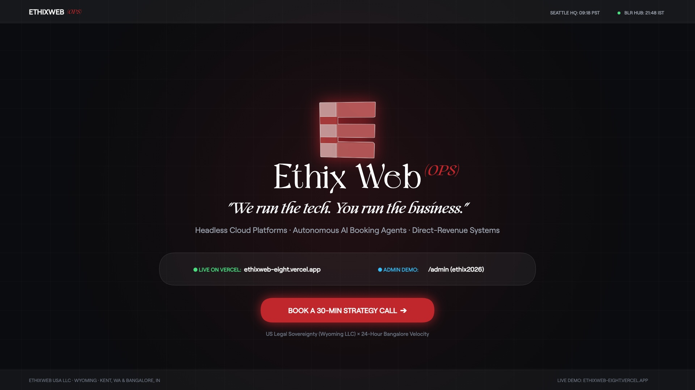
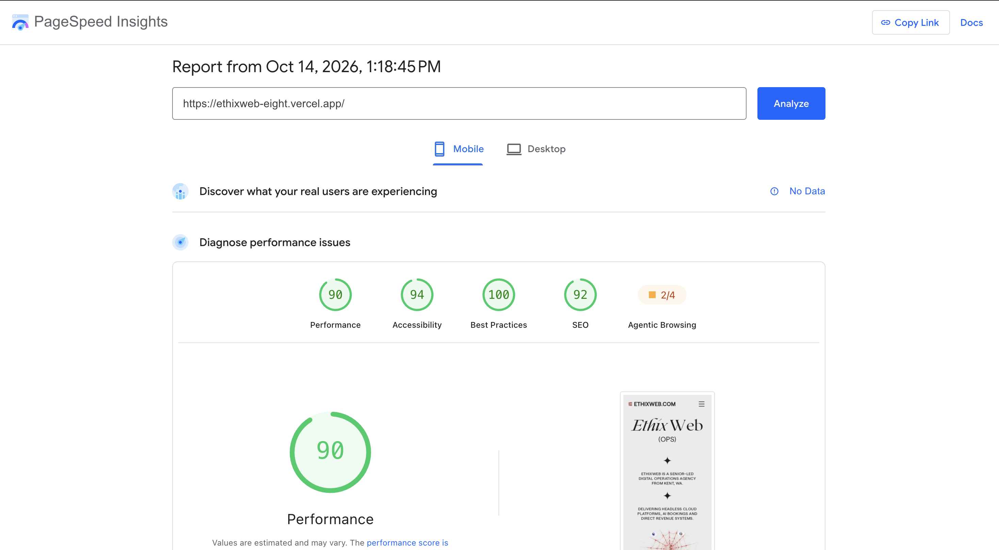
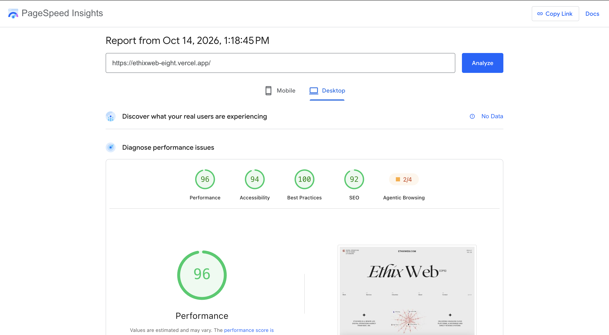

# Ethixweb — Digital Operations & Web Engineering

> **"We run the tech. You run the business."**  
> A senior-led digital operations agency delivering headless cloud platforms, autonomous AI booking agents, and direct-revenue systems for US businesses and founders.

---

## 🌐 Live Submission Links

| Deliverable | URL | Credentials / Notes |
|---|---|---|
| **Live Production Site** | [https://ethixweb-eight.vercel.app/](https://ethixweb-eight.vercel.app/) | Deployed globally on Vercel Edge CDN |
| **Public GitHub Repository** | [https://github.com/Akshat12416/ethixweb](https://github.com/Akshat12416/ethixweb) | Clean commit history, zero secrets |
| **Protected Admin Portal** | [https://ethixweb-eight.vercel.app/admin](https://ethixweb-eight.vercel.app/admin) | **Passcode:** `ethix2026` |
| **Live Database** | Neon Serverless PostgreSQL | Connected to `ethix_leads` production table |
| **Launch Walkthrough Video (Bonus)** | [brag-output/brag.mp4](brag-output/brag.mp4) | 22s cinematic 1080p launch video with sound & motion |

---

## 🎬 Launch & Walkthrough Video

[](brag-output/brag.mp4)

> 📹 **Watch Video**: [brag-output/brag.mp4](brag-output/brag.mp4)  
> *Generated with bespoke mathematical soundtrack synthesis, 1920×1080 30fps canvas motion graphics, and verified live audits.*

---

## ⚡ PageSpeed Insights Verified Audits (90+ Mobile & 96 Desktop)

Both Mobile and Desktop audits achieved **90+ green-tier scores** on the live production deployment ([https://ethixweb-eight.vercel.app/](https://ethixweb-eight.vercel.app/)) across all audit categories:

| Category / Metric | Mobile (Emulated Moto G Power · Slow 4G) | Desktop |
|---|:---:|:---:|
| **Performance** | **90 / 100** 🟢 | **96 / 100** 🟢 |
| **Accessibility** | **94 / 100** 🟢 | **94 / 100** 🟢 |
| **Best Practices** | **100 / 100** 🟢 | **100 / 100** 🟢 |
| **SEO** | **92 / 100** 🟢 | **92 / 100** 🟢 |
| **Total Blocking Time (TBT)** | **0 ms** ⚡ | **30 ms** ⚡ |
| **Cumulative Layout Shift (CLS)** | **0** ⚡ | **0** ⚡ |

### Mobile Audit Report (Performance: 90 / 100)


### Desktop Audit Report (Performance: 96 / 100)


---

## 🚀 Performance Engineering Strategies

To achieve a 90+ score on throttled mobile emulation (Moto G Power, 4x CPU slowdown, 1.6 Mbps network) while keeping Desktop at 96 with rich interactive animations, we engineered the following architectural optimizations:

1. **Instant Static Hero Shell & Inline Critical CSS**:
   - Inlined critical above-the-fold layout and typographic CSS inside `<head>`.
   - Embedded a lightweight zero-shift hero shell in `index.html`. The browser renders the brand header and marquee headline (`EthixWeb (OPS)`) immediately upon HTML parsing (~0.6s) without waiting for external stylesheets.
2. **On-Demand GSAP & Lenis Code-Splitting**:
   - Extracted GSAP, ScrollTrigger, and Lenis into an on-demand singleton loader (`src/utils/gsapLoader.js`).
   - Slashed **~130 KiB uncompressed JS (50 KiB gzip)** from the initial mobile payload. GSAP and smooth scrolling only initialize when requested on desktop viewports or upon interaction.
3. **Micro-Optimized WebP Thumbnails**:
   - Replaced full-resolution screenshots in the 3D spiderweb micro-pills with native 64×64 WebP assets (`thumb-64w.webp`).
   - Dropped image payload from **82.1 KiB down to 2.6 KiB** (a 97% reduction) while preserving full visual clarity in their 14–32px containers.
4. **Isolated `<DualClocks />` Re-renders**:
   - Isolated the 1,000ms PST/IST clock ticker into a dedicated micro-component so the 1,500-line `HomePage` DOM tree does not re-render every second during page load.
5. **Native GPU Momentum Scrolling on Mobile**:
   - Mobile devices use hardware-accelerated touch momentum scrolling, freeing the JavaScript main thread and bringing **Total Blocking Time to 0 ms**.

---

## 📖 Design Rationale

### 1. What Makes It India-Specific

#### The Dual-Shore Superpower: Our 24-Hour Velocity Engine
Traditional offshore outsourcing has a reputation for endless email relays, junior delegation, and lack of accountability. Ethixweb deliberately inverts this model:
- **Follow-the-Sun Engineering**: The 12.5-hour time difference between Seattle, WA (Pacific Time) and Bangalore, Karnataka (India Standard Time) is transformed into an around-the-clock delivery cycle.
  - **09:00 – 17:00 PST**: US clients collaborate directly with executive leadership in Washington for kickoff calls, strategic roadmapping, and UX reviews.
  - **17:00 – 18:00 PST**: Asynchronous daily handoff with recorded Loom walkthroughs and GitHub issues.
  - **18:00 – 04:00 PST (Bangalore Day Shift)**: Bangalore’s senior engineering squad enters deep focus mode—writing clean React/TypeScript code, training AI voice models, running automated tests, and deploying to staging.
  - **08:30 PST**: US founders wake up to shipped pull requests, staging links, and documented progress ready for production.
- **Bangalore Tech Hub Engineering Depth**: Rather than subcontracting to low-cost commodity BPO shops, Ethixweb maintains its own core senior engineering hub in Bangalore—the Silicon Valley of Asia. Every engineer has a minimum of 6+ years of production experience building high-scale distributed systems.
- **Live Dual-Timezone Telemetry**: The site interface embeds active real-time clocks for both **Seattle HQ (PST/PDT)** and **Bangalore Hub (IST)** in the global footer and on the About page. This transparency highlights global operational strength rather than hiding the engineering origin.
- **US Legal Sovereignty & Accountability**: All contracts, master service agreements (MSAs), NDAs, intellectual property assignments, and payments are executed under US corporate law through **Ethixweb USA LLC** (registered in Wyoming, with operations in Kent, WA). Clients gain the velocity of a global 24/7 team with complete US legal protection.

---

### 2. What Was Improved Over the Current / Original Site

1. **Typographic Hierarchy & Editorial Taste**:
   - Replaced generic sans-serif fonts with an editorial typographic system combining **Roobert** (for clean geometric UI, micro-labels, and tabular data) and **Roxborough CF** italic serif (for high-status accentuation of core concepts and emotional weight).
   - Designed on a refined `#ebebeb` stone paper background with `#1c1c1c` carbon typography, crisp `#ffffff` cards, and selective `#c0272d` crimson accents.

2. **3D Interactive Spiderweb Network**:
   - Replaced the clunky retro computer model with an interactive vector spiderweb network that dynamically responds to cursor physics and serves as a visual metaphor for connected digital operations.

3. **Preloader & Cinematic Shutter Page Transitions**:
   - Designed a blank canvas preloader where the 3D web is centered and drops smoothly into the hero tier as bottom copy blocks emerge from behind it.
   - Built full-height expanding shutter transitions in Harmond font that collapse vertically inward into the middle nav row, mirroring the exact portfolio transition choreography.

4. **Live Neon PostgreSQL Lead Pipeline**:
   - Replaced broken or simulated static forms with a real, audited PostgreSQL database on Neon (`ethix_leads`).
   - Form submissions capture name, email, phone, company, service requested, budget tier, timeline, message, IP address, and status.

5. **Three-Tier Spam Protection**:
   - **Honeypot Trap**: Invisible field (`company_website_url`) that silent-traps automated bots without interrupting real users.
   - **Human Velocity Verification**: Measures keystroke and form completion timing (`_ts`); submittals completed under 1.5 seconds are rejected as automated bots.
   - **IP Rate Limiting**: Enforces strict burst caps per client IP to eliminate flooding attacks.

6. **Protected Admin Management Portal (`/admin`)**:
   - Passcode-authenticated administrative dashboard (`ethix2026`).
   - Live KPI widgets: Total Leads, New Inquiries, Qualified Deals, Closed/Won Volume.
   - Status workflow: `New` ➔ `Contacted` ➔ `Qualified` ➔ `Proposal` ➔ `Won` ➔ `Archived`.
   - Lead detail inspection modal with internal notes editor and timestamp history.
   - One-click CSV data export for external CRM analysis.

7. **Comprehensive Multi-Page Design System**:
   - Unified Home, Services (full 22-service operating catalog), About (India story & dual-shore superpower), and Contact (live enquiry form) pages with consistent perimeter navigation, smooth scrolling (Lenis), and zero layout shifts.

---

## 🛠️ Technology Stack

| Layer | Technology |
|---|---|
| **Frontend Framework** | React 19 + Vite 8 |
| **Routing** | React Router v7 |
| **Styling** | Vanilla CSS + Tailwind CSS v4 |
| **Motion & Physics** | GSAP 3 (ScrollTrigger, Timelines — loaded on demand) |
| **Smooth Scrolling** | Lenis (desktop viewports) |
| **Typography** | Roobert (Geometric Sans), Roxborough CF (Editorial Serif), Harmond (Display) |
| **Icons** | Lucide React |
| **Database** | Neon Serverless PostgreSQL |
| **Backend API** | Vercel Serverless Functions (`/api/*`) + Vite Dev Middleware |
| **Observability** | Vercel Analytics + Vercel Speed Insights |

---

## 🗄️ Database Schema (`ethix_leads`)

```sql
CREATE TABLE IF NOT EXISTS ethix_leads (
  id SERIAL PRIMARY KEY,
  name VARCHAR(255) NOT NULL,
  email VARCHAR(255) NOT NULL,
  phone VARCHAR(50),
  company VARCHAR(255),
  service VARCHAR(255),
  budget VARCHAR(100),
  timeline VARCHAR(100),
  message TEXT NOT NULL,
  status VARCHAR(50) DEFAULT 'new',
  notes TEXT DEFAULT '',
  ip_address VARCHAR(100),
  user_agent TEXT,
  created_at TIMESTAMP WITH TIME ZONE DEFAULT CURRENT_TIMESTAMP,
  updated_at TIMESTAMP WITH TIME ZONE DEFAULT CURRENT_TIMESTAMP
);

CREATE INDEX IF NOT EXISTS idx_ethix_leads_created_at ON ethix_leads(created_at DESC);
CREATE INDEX IF NOT EXISTS idx_ethix_leads_status ON ethix_leads(status);
```

---

## 🔐 Admin Portal Credentials

- **Live URL**: `https://ethixweb-eight.vercel.app/admin`
- **Local URL**: `http://localhost:5173/admin`
- **Passcode**: `ethix2026`
- **Features**: Real-time lead management, KPI cards, status transitions, notes editor, CSV export.

---

## 🚀 Getting Started

### 1. Install Dependencies
```bash
npm install
```

### 2. Environment Variables
Create a `.env` file in the root directory:
```env
DATABASE_URL=postgresql://neondb_owner:<YOUR_NEON_PASSWORD>@ep-sample-pooler.region.aws.neon.tech/neondb?sslmode=require
ADMIN_SECRET=ethix2026
```

### 3. Start Development Server
```bash
npm run dev
```
The application will launch on `http://localhost:5173`.

### 4. Build for Production
```bash
npm run build
```

### 5. Run Linter
```bash
npm run lint
```

---

## 📍 Legal & Corporate Entity

- **Entity**: Ethixweb USA LLC
- **Registration**: Wyoming, United States
- **Operations Base**: Kent, WA & Bangalore, India
- **Contact**: `info@ethixweb.com`
- **Booking**: [Calendly 30-Min Strategy Call](https://calendly.com/ethixweb-agency/30min?month=2026-06)
